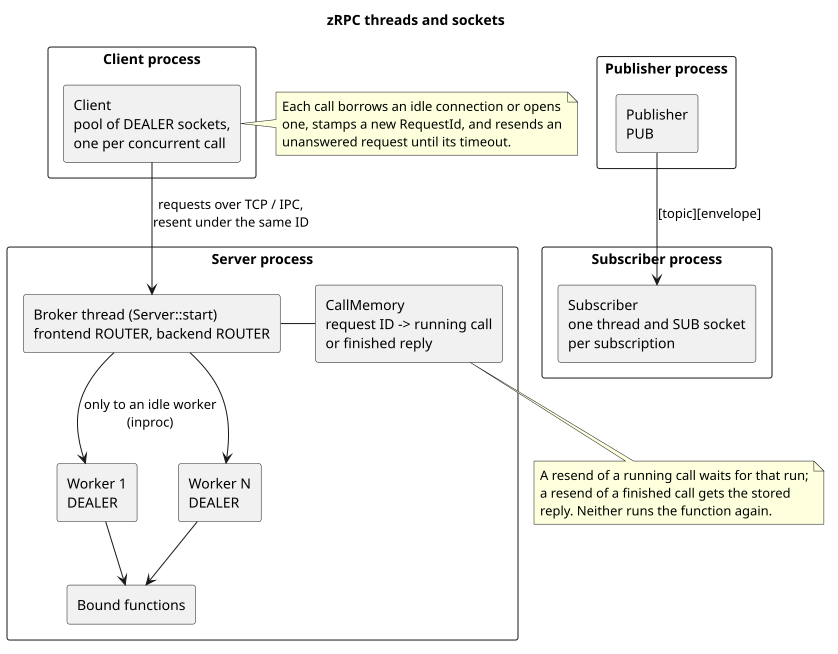
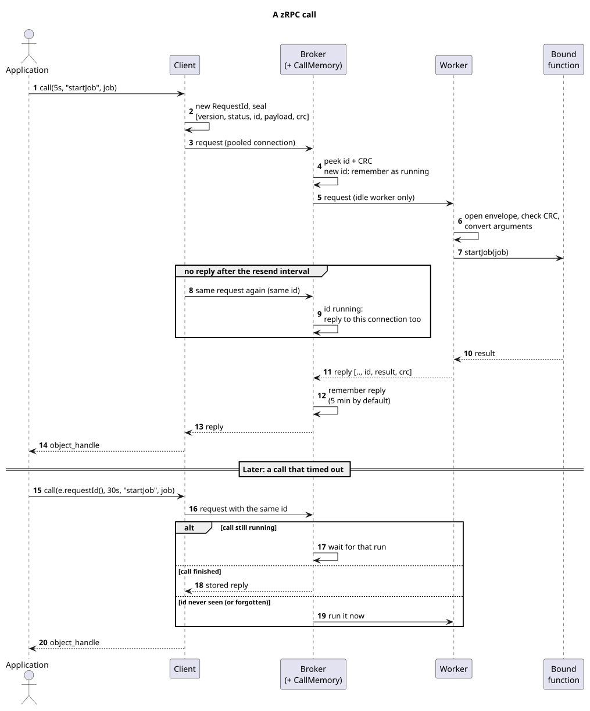
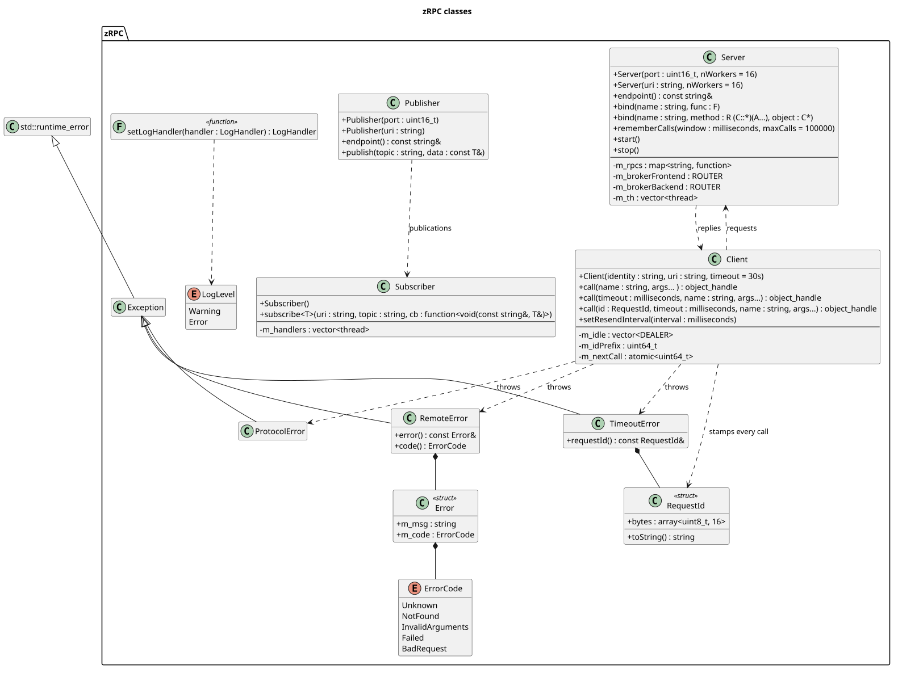

[](https://github.com/jhaws1982/zRPC/actions)
[](https://github.com/jhaws1982/zRPC/blob/master/LICENSE)

# zRPC
ZeroMQ-based RPC client/server library with MessagePack support.

This was started as a project to fill a need where I wanted an RPC server,
wanted to use C++, and wanted to hide the socket connection details. I also
wanted to utilize a modern socket library that covered more than just IP, and
found ZeroMQ to fit the bill.

In addition, this is a learning project for me to hone my C++ development
skills and delve into some more advanced concepts of C++ such as advanced
templates and scraping function traits.

Some of the ideas, in particular the approach to binding all kinds of functions
in the RPC server, were borrowed from rpclib (https://github.com/rpclib/rpclib).

## Dependencies
| Library     | Version | Description              | Package (Debian/Ubuntu) |
| ----------- | ------- | ------------------------ | ----------------------- |
| libzmq      | 4.3.2+  | 0MQ base library         | `libzmq3-dev`           |
| cppzmq      | 4.8.1+  | 0MQ C++ header-only API  | `cppzmq-dev`            |
| msgpack-cxx | 6.0+    | MessagePack C++ headers  | `libmsgpack-cxx-dev`    |

A C++20 compiler and CMake 3.16+ are required. libzmq must be installed.
cppzmq and msgpack-cxx are used from the system when found; otherwise CMake
downloads them (cppzmq 4.10.0, msgpack-cxx 7.0.0) unless
`-DZRPC_FETCH_DEPS=OFF`. zRPC does not use Boost, although a distribution's
msgpack-cxx package may pull it in.

## Building
```sh
cmake -S . -B build
cmake --build build
ctest --test-dir build
```

| Option                    | Default     | Effect                                                     |
| ------------------------- | ----------- | ---------------------------------------------------------- |
| `ZRPC_FETCH_DEPS`         | `ON`        | Download cppzmq/msgpack-cxx with CPM when not installed     |
| `ZRPC_BUILD_TESTS`        | top level   | Build the unit tests (GoogleTest)                          |
| `ZRPC_BUILD_EXAMPLES`     | top level   | Build the example programs in `examples/`                  |
| `ZRPC_SANITIZERS`         | (none)      | e.g. `address,undefined` or `thread`                       |
| `ZRPC_INSTALL`            | top level   | Generate install and CPack rules                           |
| `ZRPC_WARNINGS_AS_ERRORS` | top level   | Add `-Werror` to zRPC's own targets (never to consumers)   |
| `ZRPC_ENABLE_COVERAGE`    | `OFF`       | Instrument for coverage; adds the `zRPC_coverage` target   |
| `ZRPC_BUILD_SHARED`       | see note    | Build a shared (`ON`) or static (`OFF`) library            |
| `ZRPC_PACKAGE_ARCH`       | build host  | Package architecture for cross builds, e.g. `arm64`        |

`ZRPC_BUILD_SHARED` follows `BUILD_SHARED_LIBS` if your project sets it;
otherwise zRPC is shared when built on its own and static when added to
another project. It only affects zRPC's own library.

## Testing
The unit tests use GoogleTest (found on the system, or downloaded). They bind
ephemeral ports, so they can run in parallel:
```sh
ctest --test-dir build --output-on-failure --parallel 4
```
To run them under sanitizers, configure with e.g.
`-DZRPC_SANITIZERS=address,undefined` or `-DZRPC_SANITIZERS=thread`, plus
`-DCPM_USE_LOCAL_PACKAGES=OFF` so GoogleTest is built with the same flags. For
ThreadSanitizer set `TSAN_OPTIONS=suppressions=$PWD/tests/tsan.supp` (libzmq is
not instrumented). With `-DZRPC_ENABLE_COVERAGE=ON`, the `zRPC_coverage`
target writes `test-reports/zRPC_coverage.xml`.

The programs in `examples/` show a client, server, publisher and subscriber.

## Using zRPC in another project
After `cmake --install build` (or installing the `libzrpc-dev` package):
```cmake
find_package(zRPC 0.1 REQUIRED)
target_link_libraries(app PRIVATE zRPC::zRPC)
```
and `#include <zRPC.hpp>`. `add_subdirectory()` and `CPMAddPackage()` work
too; tests, install rules and `-Werror` are then off by default.

## Packaging
CPack builds a runtime package (`libzrpc<major>.<minor>`: the shared library)
and a development package (`libzrpc-dev`/`libzrpc-devel`: headers and the CMake
package) as DEB, RPM (when `rpmbuild` is installed) and TGZ:
```sh
cmake -S . -B build -DCMAKE_BUILD_TYPE=Release -DCMAKE_INSTALL_PREFIX=/usr \
      -DZRPC_FETCH_DEPS=OFF -DZRPC_BUILD_TESTS=OFF
cmake --build build
cd build && cpack
```
Distribution and cross builds should use `-DZRPC_FETCH_DEPS=OFF` so that every
dependency comes from the target's sysroot. For a cross build, pass your
toolchain file and the target's package architecture, e.g.
`-DCMAKE_TOOLCHAIN_FILE=aarch64.cmake -DZRPC_PACKAGE_ARCH=arm64`. CI builds amd64
and arm64 packages for every release.

## Notes
- Any argument or return value associated with a function must be packable by
  MsgPack, otherwise you will be unable to package the argument properly for
  passing between client and server.
- A call either returns the RPC's value or throws, so the value comes out in a
  single `as` call and can never be mistaken for an error:
  ```cpp
  try
  {
    int sum = client.call("add", 2, 3).get().as<int>();
  }
  catch (const zRPC::RemoteError &e)  // the server reported an error
  {
    // e.code(): NotFound, InvalidArguments, Failed (the function threw), ...
  }
  catch (const zRPC::TimeoutError &e) {}   // no reply in time
  catch (const zRPC::ProtocolError &e) {}  // corrupt or incompatible reply
  ```
- Calls give up after the client's timeout (30 s unless the `Client` is built
  with another). Pass a duration to time one call differently, e.g.
  `client.call(500ms, "add", 2, 3)`, or `zRPC::kWaitForever` to wait
  indefinitely.
- Each call runs at most once on the server. Every call has a request ID; a
  client resends a request it has no reply to (every second by default, see
  `Client::setResendInterval()`), and the server answers a resend of a
  running call when that run finishes, and of a finished call from memory,
  without running it again. If a call still times out it may or may not
  have run; retry it with its ID and it still runs at most once:
  ```cpp
  try
  {
    client.call(5s, "startJob", job);
  }
  catch (const zRPC::TimeoutError &e)
  {
    client.call(e.requestId(), 30s, "startJob", job);  // same name and args
  }
  ```
  The server remembers finished calls for 5 minutes, at most 100,000 of them
  and 256 MiB of their replies (`Server::rememberCalls()`). Past the byte
  budget the oldest replies are dropped, and a resend of such a call gets a
  `ReplyUnavailable` error rather than running it again. The memory does not
  survive a restart, so a call resent to a restarted server, or retried
  after the window, can run again. Functions that must never repeat should
  also be safe to repeat.
- Clients reuse their connections: a client keeps one connection per call it
  has had in flight at once.
- Every request, reply and publication is a CRC-32 protected envelope
  `[version, status, request id, payload, crc]`; replies echo the request's
  ID. The CRC detects accidental corruption, not tampering; use 0MQ CURVE
  security on untrusted networks.
- zRPC never writes to stdout. Problems on its own threads (a dropped
  publication, a subscription callback that throws, a server thread that
  stops) go to a log handler, `std::cerr` by default:
  `zRPC::setLogHandler([](zRPC::LogLevel level, const std::string &msg) { ... });`
  An empty handler discards them.
- There is no built-in way to stop a server remotely, and no authentication.
  If clients should be able to stop the server, bind an RPC for it yourself:
  `srv.bind("terminate", [&srv]() { srv.stop(); });`

## Design
How a client, broker and workers fit together:



One call, including a resend and a retry after a timeout:



The public classes:



The diagrams are PlantUML sources in `docs/`. After editing one, regenerate
the SVGs with `java -jar plantuml.jar -tsvg docs/*.puml` (Graphviz is needed
for the class diagram).

## TODO
- Subscribe to generic (untyped) data, e.g. by receiving a
  `msgpack::object_handle` instead of a fixed type

## BUGS
- None known.